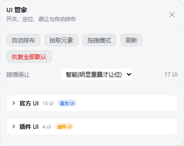
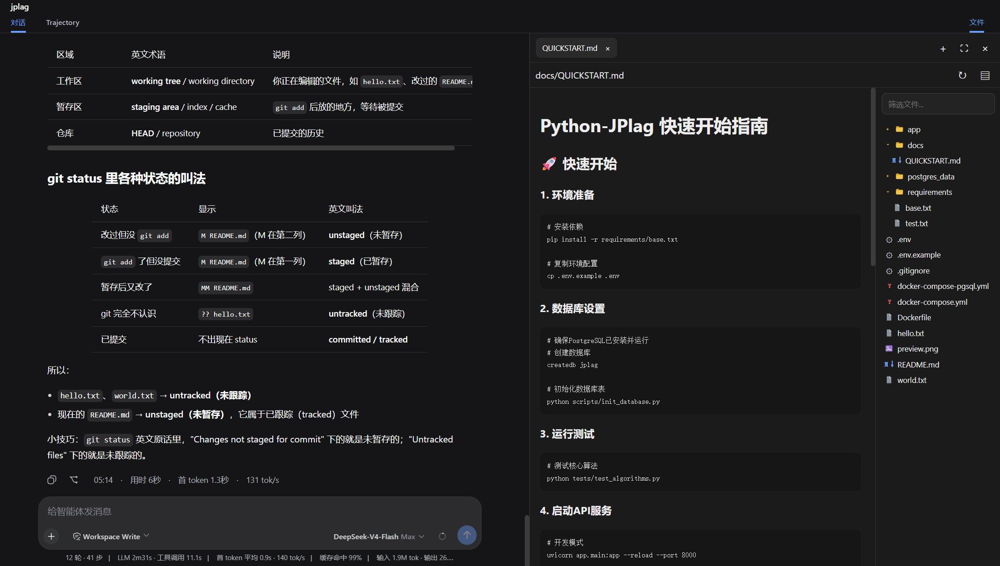
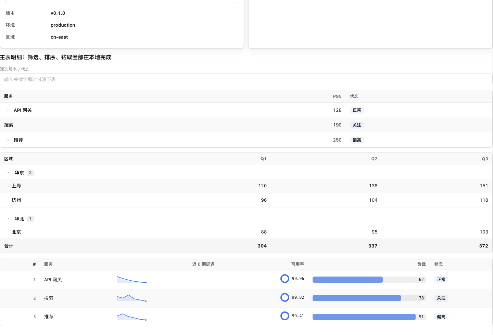
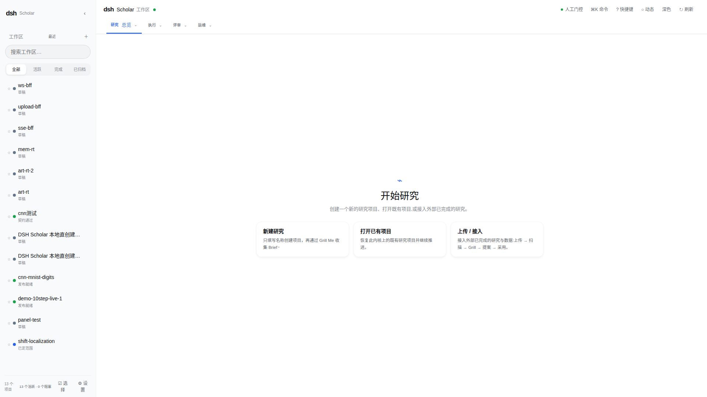
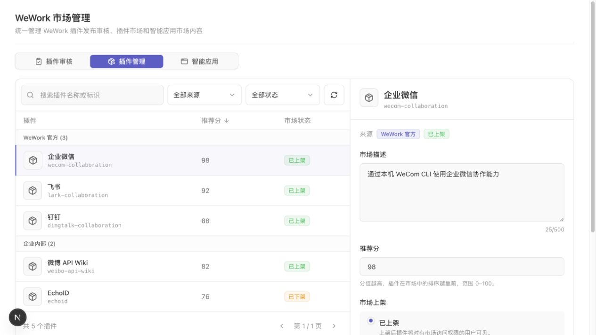

# 可借鉴总表

正表 272 条。判定已与 [catalog.json](catalog.json) 和分主题卡片对齐：思想可取 53，只借机制 86，暂缓 86，拒绝 47。分组仍是：连接器 74，界面 72，办公内容 47，任务与注意力 33，知识记忆 29，审批 17。

思想可取只表示与上游界面或短回执相容，不进入排期。深读收紧过的仓库，卡片上的判定就是深读边界。

## 统一结论

社区插件没有补上手册里仍开着的座席项：GitLab 令牌、量子平台地址、研究时钟的真实一轮、企业身份和全公司事实源。272 条目录解决不了这些。

公司开发桌面的会话预设已经是上游 `standard`。文件、壳、差异和侧栏若在标准预设里已有，就不要用社区插件再做一层。公司插件只登记工具并转调。`packages/company-agent-policy/src/index.js` 已经在 `tools/pre-execute` 上做了三件事：合同内工具走 `authorize`；问询无法送到 `lab` / `sign` 的批准通道时改成拒绝；`company_`、`quantum_`、`hpc_` 开头但不在合同里的名字直接拒绝。合同外的上游工具返回空并 `next()`，留给标准预设。

因此深读里的批准插件大多是在核对这条缝，不是在发现缺口。

| 社区做法 | 和公司缝的关系 |
| --- | --- |
| `safety-net`：致命不可降级；没有批准通道就拒绝；判定抛错也拒绝 | 前两条公司策略已经有。`tools/pre-execute` 已把 `authorize` 的异常收成拒绝。不安装该插件，也不引入它的壳层规则表 |
| `dsh-approval-gate` 无人值守时 `next()`；`uncertainPolicy` 允许放行 | 与公司缝相反。用作反例，不抄 |
| `dsh-riskproof` 的 observe 模式在拒绝后仍 `next()` | 观察不能变成放行。出处字符串可以出现在拒绝原因里，公司设备原因已经带 `circuit_id` 和 `shots`，并有长度上限。不必再做跨工具污点追踪 |
| `thoughtdag` 对同一工具、同一参数 `allowed-once` | 与授权卡相反。卡按次数和有效期，不按参数永久记住 |
| `dsh-task-status` 替换 `ctx.jobs.read` | 为了进度条改宿主游标。进度若需要，用会话事件上的短状态行（`working-activity` 的 `publish` 默认关闭），不要换掉官方 read |
| `dsh-genui` / `dsh-visualize` 把界面片段写进回复 | 公司结果保持短文本。没有浏览器时退回文本，只是在重复已有规则，不新增提示词段落 |
| `dsh-kb-sieve` 把全文放进会被发现的技能根 | 检索可以留在工具内。不自动发布技能 |
| `dsh-scholar` 先启动侧车内核 | 文献工具已有短回执。不接入研究操作系统 |
| `pptfast` 单个预览工具登记失败只跳过自己 | 办公工具已有。登记失败要隔离，避免一个预览拖垮整包。这是注册方式，不是新渲染器 |
| 市场「安装即启用」 | 命令行档案保持 system-trust。发现页可以看，不提供安装 |

调研里值得落进现有文件的两件已经落地：

1. `company-agent-policy` 的 `tools/pre-execute` 在 `authorize` 抛错时返回拒绝。对照 [D17](deep/D17-safety-net.zh-CN.md) 的「判定过程异常即拒绝」，不引入它的壳层规则表。
2. 授权卡的反例已钉住：同一参数再次调用、无人值守、观察模式，都不能把询问变成放行。对照 [D14](deep/D14-dsh-approval-gate.zh-CN.md)、[D15](deep/D15-dsh-riskproof.zh-CN.md)、[D09](deep/D09-thoughtdag.zh-CN.md)。

其余深读是界面备忘或明确不采纳。办公、工作树、一轮实验卡、短回执，手册第 3 节已经写了落点。

## 界面

下面的图都是仓库里自带的界面文件，抄进 `ui/` 只为对照。它们不是公司开发桌面的实拍。没有自带可显示界面图的项目不配图。`dsh-visualize` 仓库里的静图是宣传画，动图文件无法作为静帧嵌入，因此不放。

UI 管家只枚举官方界面和插件界面，宿主不因此获得工具。判定维持思想可取，留在上游。来源：`dsh-ui-hub` 提交 `219fe63a65de` 的 `docs/assets/screenshot-panel-zh.png`。

侧栏把对话、文件树和终端放在同一窗口。判定是暂缓：终端进程由插件自己保存。来源：`dsh-side-panel` 提交 `baca7806714a` 的 `assets/overview.png`。

GenUI 把可筛选的表和火花线画进回复。判定是暂缓：公司结果保持短文本。这张图没有会话栏。来源：`dsh-genui` 提交 `8ed3999147d0` 的 `assets/showcase-panel.png`。

Scholar 是另一套带项目列表的研究工作台。判定是暂缓。来源：`dsh-scholar` 提交 `086b19a2fbd7` 的 `docs/assets/dsh-scholar-home-zh.png`。

Wegent 的市场管理页带上架和下架。判定维持暂缓：发现可以看，不把社区包装进受管档案。这张是仓库 `docs/assets/product-design/` 里的设计稿，提交 `1149631ab4df`。

与上图同一套判定、没有配图的条目：`dsh-key-limits`、`dsh-share`、`dsh-conversation-share`、`dsh-prompt-studio` 为拒绝；`dsh-at-file`、`session-titler`、`DSH-better-sidebar`、`dsh-tianshu-tui` 为暂缓；`dsh-need-finder` 与另外五个目录插件为只借机制。`dsh-focus-chat` 仍是思想可取：只留最终结果，上游若已折叠工具行则不排期。

## 深读证据

开发桌面继续用上游 `standard` 预设。下面各条是静态阅读钉住的机制，供对照，不构成安装清单。

### 界面

- 差异视图包住已有的 `edit` / `write`。见 [D06](deep/D06-dsh-diff-viewer.zh-CN.md)。呈现层可以留在上游，公司不新写写入工具。
- 布局管家和批注的宿主 `apply` 为空，权限不因界面增加。见 [D04](deep/D04-dsh-ui-hub.zh-CN.md)、[D13](deep/D13-dsh-annotation.zh-CN.md)、[D10](deep/D10-dsh-visual-edit.zh-CN.md)。
- 活动行默认不写回会话日志。见 [D12](deep/D12-working-activity.zh-CN.md)。
- 会话衔接只在第一回合的第一步注入一行，下游已拒绝时原样返回。见 [D25](deep/D25-dsh-session-continuity.zh-CN.md)。公司 `recover` 已只回短字段，不必再注入交接文件。
- 侧栏自管终端进程，见 [D03](deep/D03-dsh-side-panel.zh-CN.md)。实时画布自带沙箱站点，见 [D11](deep/D11-dsh-live-canvas.zh-CN.md)。

### 任务与工作树

上游 Router、订阅和注意力面板承接没有逐条输入的任务。

- 计划别名拒绝 `..`。见 [D18](deep/D18-file-planning.zh-CN.md)。磁盘计划不是工单权威。
- 工作树工具登记进当前会话的工具表。见 [D19](deep/D19-worktree-mgr.zh-CN.md)、[D20](deep/D20-dsh-worktree-flow.zh-CN.md)。公司已是一工单、一次会话、一个工作树。
- 本地变更账本只覆盖工作区文件。见 [D05](deep/D05-dsh-turn-rewind.zh-CN.md)。
- `ikanban` 这次提交没有组合补丁。见 [D08](deep/D08-ikanban.zh-CN.md)。

### 知识、办公、市场

- 文档索引后层补丁整段替换配置。见 [D24](deep/D24-docindex.zh-CN.md)。
- 没有裁判模型时压缩插件不改会话，且不追加自定义事件类型。见 [D21](deep/D21-sieve.zh-CN.md)。独立裁判端点不接。
- 全文知识包会进入技能根。见 [D23](deep/D23-dsh-kb-sieve.zh-CN.md)。记忆订阅见 [D22](deep/D22-REMI.zh-CN.md)。侧车内核见 [D28](deep/D28-dsh-scholar.zh-CN.md)。
- 预览工具逐个登记，公文规则留在 CLI。见 [D26](deep/D26-pptfast.zh-CN.md)、[D27](deep/D27-gongwen-skill.zh-CN.md)。交付仍是 `company_office_*` 与 WPS。
- 市场安装即启用，见 [D29](deep/D29-dsh-agent-plugins-market.zh-CN.md)。Wegent 抽查的插件入口是空 `apply`，见 [D30](deep/D30-Wegent.zh-CN.md)。
